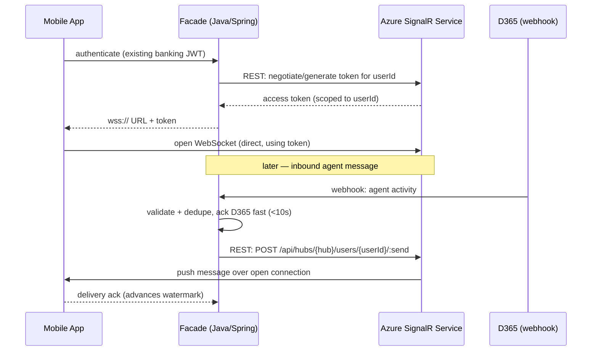
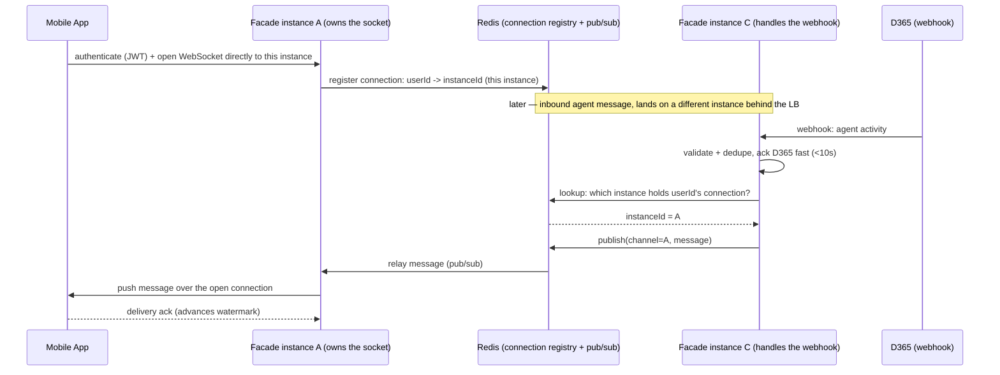

# ADR-0001: Real-time transport for facade → mobile delivery

Status: **draft — decision not yet made, needs stakeholder input** (see §8)
Relates to: [chat-facade-architecture-summary.md](./chat-facade-architecture-summary.md), [sd-roadmap.md](./sd-roadmap.md) Phase 2
Decision owner: TBD (platform/infra lead + backend eng lead — confirm in Phase 0)

## 1. Context

The facade needs to push inbound agent messages (and later, potentially other event types — transaction alerts, fraud confirmations) to a connected mobile app in near-real-time, with "send to a specific user, fan out to all their active devices/sessions" as the core primitive, plus reconnect-with-backoff and gap-catchup on the client side.

Three options, per the original architecture summary:

1. **Azure SignalR Service**
2. **Azure Web PubSub**
3. **Self-managed WebSocket gateway + Redis pub/sub**

The summary recommended an Azure-native managed option over self-managed "since it's Azure-native and handles multi-instance fan-out ('send to user') for us" — but did not compare the two Azure options against each other, and self-managed was not seriously scored. This ADR does that comparison.

## 2. Facts pulled from current Microsoft documentation

(Fetched live — Aug 2026 — because pricing/tiers/limits on these services move and shouldn't be answered from training memory. Exact $ figures still need to come from the Azure Pricing Calculator for our subscription/region/commitment — see §8.)

**Azure SignalR Service**
- Tiers: Free, Standard, Premium.
- Programming model is built around ASP.NET Core SignalR "Hubs." For non-.NET backends (our case — Java/Spring Boot), you use the **REST API** instead of the Hub abstraction — you lose typed hub methods, strongly-coupled connection lifecycle helpers, etc., and work at a lower level (`send user <id>`, `send group`, `broadcast`).
- Native "send to user / group / broadcast" primitives exist via REST API — the fan-out primitive we need is present even from Java.
- Scale-out: up to 100 units per instance on Standard; Premium_P2 SKU extends beyond that.
- **Autoscale is Premium-tier only** (Azure Monitor autoscale integration, scales unit count to load automatically).
- Free tier: 1 unit, ~20 concurrent connections, capped daily messages — dev/test only, not relevant to production sizing.

**Azure Web PubSub**
- Tiers: Free, Standard, Premium_P1, Premium_P2.
- Ships a **native Java server SDK** (`com.azure.messaging.webpubsub`) — `WebPubSubServiceClient`, `sendToAll`, per-user token issuance (`GetClientAccessTokenOptions.setUserId`), all first-class, not a REST-API-only fallback.
- **Client SDK has built-in reconnect-after-drop with reliable, ordered message redelivery** — i.e., the delivery-watermark/at-least-once pattern the architecture summary designs by hand is partially provided by the SDK itself for the transport hop (still need our own end-to-end ack for the "app persisted it" guarantee, but the transport-level reliability primitive already exists).
- Each unit = 1,000 concurrent connections (Standard tier); scales to 100 units on Standard/Premium_P1, and 100–1,000 units on Premium_P2.
- Single resource can scale to **up to 1 million concurrent connections** (stated ceiling, enterprise scenario).
- Premium tier: Azure Monitor autoscale, **automatic zone redundancy**, and **geo-replication** for regional failure handling and serving global users.
- Uses an explicit event-handler/webhook model for connect/disconnect/message events (`az webpubsub hub create --event-handler ...`) — this is architecturally close to the D365 webhook pattern already in the design, so the team would be applying the same webhook-receiver skillset on both integration points.

**Self-managed WebSocket + Redis** — no vendor docs needed; this is a build-it-ourselves option (e.g., Spring WebSocket/STOMP endpoints behind a load balancer, Redis pub/sub for cross-instance fan-out). Facts below are architectural reasoning, not a vendor claim.

**Regional availability (UAE)** — checked directly against the current Azure pricing pages (Aug 2026), since this matters for data residency (roadmap §4.2):
- **Azure SignalR Service**: listed as available in both **UAE North** and **UAE Central**.
- **Azure Web PubSub**: listed as available in both **UAE North** and **UAE Central**.
- Caveat: **UAE Central is an access-restricted region** (Abu Dhabi) — appearing on the pricing page confirms it's a real, priced region, but historically Microsoft has required explicit subscription-level enablement before a given subscription can actually deploy into it. Appearing in the pricing dropdown is not proof our subscription already has access — confirm via `az account list-locations` (or the portal region picker) against the actual target subscription before this becomes a planning assumption (see §8). A stale Microsoft Q&A thread claiming SignalR wasn't available in UAE North also surfaced during this check — disregarded as outdated (predates the region's GA), but it's a reminder to re-verify at build time rather than freeze this fact permanently into the design.

## 3. Comparison — complexity and cost

| Dimension | Azure SignalR Service | Azure Web PubSub | Self-managed WS + Redis |
|---|---|---|---|
| **Build complexity (Java backend)** | Medium-high — no native Java server SDK; REST API only, hand-roll auth/token/negotiate flow and reconnect semantics against Microsoft's HTTP contract | Low-medium — native Java server + client SDKs, negotiate/token pattern documented directly for Java, reconnect+ordered-redelivery handled by client SDK | High — build negotiate endpoint, connection registry, heartbeat/reconnect logic, Redis pub/sub fan-out, "send to user across instances" primitive, and dedupe/ordering all ourselves |
| **Operational complexity** | Low — managed service, but Hub-oriented docs/tooling/samples skew .NET, so troubleshooting guidance and community answers will often need translation to our REST-API usage | Low — managed service, and docs/samples already reflect a Java-first, protocol-level model that matches how we'd actually use it | High — we own scaling policy, failover, patching, Redis HA/failover, connection-count capacity planning, and on-call runbooks for a stateful gateway tier |
| **Team familiarity fit** | Depends — if the team has .NET/SignalR background elsewhere in the org, conceptually familiar; if purely Java shop, the Hub-centric docs are a mismatch even though REST works | Depends — newer service, likely less prior team exposure, but the docs/SDK story is a closer match to our actual stack | Depends — most "familiar" if the team already runs Spring WebSocket + Redis elsewhere, but familiarity doesn't remove the ongoing ops burden |
| **Cost shape** | Unit-based pricing (Free/Standard/Premium), scales with concurrent connections and messages; autoscale only on Premium so Standard-tier cost requires manual capacity planning or headroom over-provisioning | Unit-based pricing (Free/Standard/Premium_P1/P2), 1,000 connections/unit; autoscale on Premium; per-unit cost needs to be pulled from current pricing calculator for direct $ comparison against SignalR | No per-connection vendor fee, but real cost is compute (VM/AKS nodes) + Azure Cache for Redis (HA tier) + **ongoing engineering time** to build and operate — often the largest hidden cost of the three options |
| **Time-to-market** | Faster than self-managed, slower than Web PubSub for a Java team (more translation effort from .NET-oriented examples) | Fastest for a Java backend given native SDK and matching examples | Slowest — full build-and-harden cycle before it's production-safe |

**Preliminary read:** for a Java/Spring Boot facade specifically, Web PubSub looks like the stronger default over SignalR Service on build complexity and delivery-reliability primitives, not just "which Azure service is generically nicer" — this is a fact the original summary didn't have (it recommended "SignalR or Web PubSub" without differentiating by backend language). Self-managed is the weakest option on both complexity and true fully-loaded cost unless there's a strong pre-existing reason (e.g., an already-running Redis-backed gateway platform) to prefer it. This is a preliminary read, not the ADR decision — needs the stakeholder input in §8 before it's final.

## 4. Proposed additional quality attributes

Complexity, cost, and team familiarity (the three criteria in the original open question) leave out several attributes that matter for a **regulated banking chat channel** specifically. Proposed additions to weigh before deciding:

1. **Reliability / delivery guarantees fit** — does the transport's built-in reconnect/ordering behavior reduce or duplicate the work the facade already has to do for the delivery-watermark pattern? (Web PubSub's client SDK does meaningful work here already; worth confirming exactly where its guarantee ends and our own ack layer must begin, rather than assuming full overlap.)
2. **Scalability ceiling & headroom** — max connections per instance/resource, and how scaling out behaves under a load spike (e.g., a P1 incident driving simultaneous support chats). Web PubSub's stated 1M-connection ceiling and Redis's fan-out limits both need sizing against realistic peak concurrent SME users, not just current volume.
3. **HA / disaster recovery / multi-region** — zone redundancy and geo-replication are Premium-tier-gated on both Azure options; self-managed means we build this ourselves (multi-AZ deployment, Redis failover). Given this carries customer support chat (not the core banking ledger), what RTO/RPO does the business actually require here?
4. **Security & network isolation fit for a banking workload** — Private Link/VNet integration, managed identity support (vs. connection-string secrets), and how each option's auth model integrates with existing platform secret management. This is likely to matter to the security review in SD Phase 5.
5. **Vendor lock-in / portability** — self-managed is the most portable (standard WebSocket, swappable), Azure SignalR's Hub-flavored docs/tooling are the most Azure/.NET-flavored conceptually (though REST usage itself isn't uniquely locked in), Web PubSub sits in between. Worth asking whether portability off Azure is a real constraint or a theoretical one for this org.
6. **Operational observability / support model** — built-in metrics and diagnostics surfaced through Azure Monitor for both managed options vs. instrumenting everything ourselves for self-managed; also consider Microsoft support SLA vs. purely internal on-call for a self-managed tier.
7. **Consistency with the D365 integration pattern already chosen** — Web PubSub's event-handler/webhook model for connection lifecycle events mirrors the webhook-receiver pattern the team is already building for D365 inbound messages. Reusing one architectural pattern (webhook receiver, ack-fast-process-async, retry/dedupe) across two integration points is a real complexity reduction versus operating two conceptually different real-time mechanisms in the same system.
8. **Future extensibility to other event types** — the summary already flags a plan to push transaction alerts/fraud confirmations over the same channel later. Which option's primitives (topics, groups, hubs) best support adding unrelated event types onto the same connection without redesigning the fan-out model?

## 5. Suggested scoring approach

Rather than a single "winner" from a gut call, score each option 1–5 against the criteria in §3 + §4, weighted by what actually matters to this org (e.g., if compliance treats HA/DR as hard-mandatory, weight it higher than cost). Recommend running this as a short workshop with backend eng + platform/infra + security, not a solo decision — the outcome becomes the ADR's final "Decision" section.

## 6. Connection model & lifecycle

This section captures the mechanics of how a device actually registers and stays reachable — established while reviewing this ADR, and load-bearing for the security (§4.4), reliability (§4.1), and scalability (§4.2) criteria above. Written against Web PubSub's documented behavior; SignalR Service is conceptually the same (per-user token, disconnected event, no persistent server-side memory of a dead socket) but confirm the exact mechanism if that option is still live when this ADR is finalized.

### 6.1 Registration — one connection per device, not one instance per device

There is a single shared Azure resource (the "hub"); every connected device holds its own individual WebSocket connection into it — not a dedicated instance per device. Flow:

1. Device authenticates to **our facade** (existing banking session/JWT) — never touches Azure directly.
2. Facade calls the service's token-issuance API (its own `/negotiate`-style endpoint, backed by the Azure SDK) to mint a short-lived access token **scoped to that `userId`**.
3. Facade returns a `wss://...access_token=...` URL to the device.
4. Device opens the WebSocket directly to Azure using that token.

### 6.2 Isolation — targeted unicast, not broadcast fan-out

The service supports broadcast/topic primitives (`sendToAll`, `sendToGroup`) — that's where the "pub/sub" name comes from — but our design uses **`sendToUser` exclusively**. The `userId` is embedded in the connection's access token by Azure at connect time, so when the facade calls "send to user X," the service routes the payload only to connections currently tagged `userId = X`; every other connection on the same shared resource never sees it structurally, not just by convention.

**Multi-device fan-out is not a scenario this system needs to handle.** Confirmed platform constraint: only one device may be associated with a given user at a time, so `sendToUser` will only ever have (at most) one live connection to target — there's no simultaneous phone+tablet delivery or cross-device read-state reconciliation problem to design for, and no dedicated ADR is needed for it (this was a candidate in the roadmap's Phase 2 list; discarded).

**Resolved (was open in an earlier draft of this ADR): enforcement doesn't need to be built at this layer at all.** The constraint is enforced upstream by the **Identity Provider** — a user's IDP profile doesn't permit more than one device/session to be associated with it concurrently, which is the restriction the org already operates under. Since `POST /chat/connection/negotiate` requires a valid banking-session JWT, and the IDP guarantees at most one valid session per user exists at a time, two devices can't both hold a currently-valid session to negotiate a Web PubSub connection with in the first place — the "does Azure's service have a concept of one-connection-per-user" question (it doesn't, per above) turns out not to matter, because the precondition for a second valid connection never arises. No refuse-vs-displace logic needs to be built in smb-chat-service.

One residual, low-priority nuance worth naming rather than silently assuming away: an already-*open* WebSocket connection isn't necessarily torn down the instant the IDP invalidates its underlying session (a live socket doesn't typically re-validate the JWT on every frame) — so a brief overlap window between a new device's session becoming valid and an old device's socket actually closing is plausible in principle. Not treated as something to engineer around here, since the org has confirmed this is the accepted operating restriction and not something this project owns fixing.

Confidentiality note for the security review: the WebSocket is a **direct device ↔ Azure connection** — message payloads transit Azure's infrastructure over TLS on the way to the device, not just our own network. Private Link/VNet integration (Premium tier) narrows *our backend's* path to the service, but the device-facing edge is inherently public-internet-facing on both Azure options.

### 6.3 Recommended connection-lifecycle scoping: tied to conversation state, not app-foreground or screen visibility

Three possible scopes were considered:

| Scope | Connection open when... | Assessment |
|---|---|---|
| App-session scoped (as in the original architecture summary) | App is foregrounded, regardless of any conversation | Holds a live, billed, confidentiality-capable channel open for every foregrounded user whether or not they're chatting — inflates connection count/cost and exposure window without a confirmed reason |
| Screen scoped | Chat screen specifically is on-screen | Worse: drops the socket the moment the user taps away mid-conversation (e.g. to check balance), missing real-time delivery until they return; churns connect/disconnect on every screen transition |
| **Conversation-state scoped (recommended)** | Server-side conversation state machine is `open` or `wrap-up` — independent of which screen is currently visible, as long as the app process is alive | Matches actual usage (chat is occasional, not continuous); bounds cost and exposure to when there's something to protect; doesn't require inventing new plumbing — `GET /chat/current-session` at app startup already exists to decide whether to open the socket |

Recommended flow:
- App startup calls `GET /chat/current-session` (REST, no socket needed). Active/recent conversation found → open the socket. None found → don't.
- `POST /chat/sessions` (user starts a chat) → open the socket as part of that flow.
- Socket stays open across in-app navigation and brief backgrounding for the full `open`/`wrap-up` duration — reconnect-with-backoff (§6.4) covers gaps, not screen state.
- Conversation reaches `closed` → close the socket, optionally after a short grace period (~30–60s) to let a trailing ack/read-receipt round-trip land.
- Screen visibility itself only drives the **read watermark** (`POST /chat/sessions/{id}/read`), a separate mechanism, unrelated to whether the socket is open.

**Conditional — this recommendation flips if:** pushing unrelated event types (transaction alerts, fraud confirmations) over this same channel is a *confirmed, near-term* requirement rather than a speculative option kept open by the earlier AI-assisted exploration. If real, the channel's purpose stops being "chat delivery" and becomes general real-time notification transport, which legitimately wants to stay alive for the whole app session. **This needs a business-side answer before the ADR can close** — see §8.

### 6.4 Disconnect detection and reconnect — not a resumable session across backgrounding

Common misconception worth ruling out explicitly: Azure does **not** keep a connection "active" while the OS has silently killed it locally.

1. OS backgrounds/suspends the app; the socket stops being serviced (no pong replies to keepalive pings, eventual TCP-level failure).
2. Azure detects the drop itself (failed ping/pong or TCP failure) and fires a **`disconnected` system event** to our webhook/upstream endpoint (Web PubSub's documented `azure.webpubsub.sys.disconnected` CloudEvent, carrying `userId`/`connectionId`/`reason`). The dead connection is removed from that `userId`'s active set — a subsequent `sendToUser` correctly stops trying to reach it. This is part of why push notification has to exist as the backgrounded-state delivery path: the socket is genuinely gone server-side too, not just locally.
3. **Short-drop exception:** Web PubSub's "reliable" subprotocol (`json.reliable.webpubsub.azure.v1` / `protobuf.reliable...`) supports connection *recovery* — a brief network blip lets the client reconnect with a `connectionId` + `reconnectionToken` from the original handshake and resume the same logical session/group state, rather than starting fresh. This is built for transient blips (seconds), not app-suspend durations (minutes+) — **exact recovery-window duration needs to be pulled from current docs during Phase 3, not assumed** (see §8).
4. For a real backgrounding episode, foreground resume is a **fresh connect, not a resume**: re-negotiate for a new token → open a new WebSocket (retagged with the same `userId`, Azure has no memory of "this device was here before" beyond the identity claim) → run the **catch-up call** against the facade ("everything since my last watermark"). The watermark-based catch-up, not the reconnect itself, is what actually guarantees no message was lost in the gap.

## 7. Sequence diagrams by option

Each diagram shows the same representative flow — device registration/negotiate, then the facade delivering an inbound D365 agent message to the device — so the three options can be compared on the same footing. Reconnect/disconnect mechanics are covered in §6.4 and not redrawn here.

### Azure SignalR Service (Java backend — REST API, no native Hub SDK)



No native Java server SDK — every step from the facade to SignalR is a hand-rolled REST call against Microsoft's HTTP contract, including the negotiate/token step (§2, §3).

### Azure Web PubSub (native Java SDK)

```mermaid
sequenceDiagram
    participant Mobile as Mobile App
    participant Facade as Facade (Java/Spring)
    participant WPS as Azure Web PubSub
    participant D365 as D365 (webhook)

    Mobile->>Facade: authenticate (existing banking JWT)
    Facade->>WPS: SDK: service.getClientAccessToken(userId)
    WPS-->>Facade: access token (scoped to userId)
    Facade-->>Mobile: wss:// URL + token
    Mobile->>WPS: open WebSocket (direct, using token; reliable subprotocol)

    Note over Facade,WPS: later — inbound agent message
    D365->>Facade: webhook: agent activity
    Facade->>Facade: validate + dedupe, ack D365 fast (<10s)
    Facade->>WPS: SDK: service.sendToUser(userId, message)
    WPS->>Mobile: push message over open connection
    Mobile-->>Facade: delivery ack (advances watermark)
```

Same shape as SignalR, but every facade-side step is a native Java SDK call (§2) rather than a hand-built REST request — the negotiate and send steps are one-liners, and the client SDK adds built-in reconnect/ordered-redelivery on top (§6.4).

### Self-managed WebSocket + Redis



Everything SignalR/Web PubSub give for free — token issuance, "send to user," multi-instance fan-out — has to be built and operated here: the connection registry, the cross-instance relay, and the routing lookup are all our own code and our own on-call surface (§3, §4.6).

## 8. Open items before this ADR can be finalized

- [ ] Pull actual current per-unit pricing for SignalR Standard/Premium and Web PubSub Standard/Premium_P1/P2 from the Azure Pricing Calculator, scoped to our subscription/region/commitment tier (the numbers above are structural, not $-quantified).
- [ ] Confirm whether the org has existing Azure footprint/reserved capacity/EA discounts that make one option cheaper in practice regardless of list price.
- [ ] Confirm required RTO/RPO for this channel from the business (feeds §4.3).
- [ ] Confirm Private Link/VNet-integration requirement from security (feeds §4.4, §6.2).
- [ ] Confirm our actual target subscription has enabled access to UAE Central specifically (`az account list-locations` or portal region picker) — it's an access-restricted region; pricing-page listing alone isn't proof of subscription-level access (see §2 regional availability note).
- [ ] Confirm expected peak concurrent chat sessions (needed to size units/instances for either managed option, or node/Redis capacity for self-managed) — currently unknown, flagged in the roadmap's open questions too.
- [ ] **Confirm whether pushing other event types (transaction alerts, fraud confirmations) over this same channel is a real, near-term requirement** — decides between conversation-state-scoped vs. app-session-scoped connection lifecycle (§6.3). Currently unconfirmed; treat as speculative until stated otherwise.
- [ ] Pull the current documented connection-recovery window for Web PubSub's reliable subprotocol (§6.4) before relying on it in the reconnect design.
- [ ] Run the scoring workshop (§5) with the actual stakeholders, not as a unilateral engineering call, given this feeds a compliance-relevant channel.
- [x] ~~Decide how the single-device-per-user constraint is technically enforced~~ (§6.2) — **resolved: not our problem to solve.** Enforced upstream by the Identity Provider (one session per IDP profile) — smb-chat-service builds no refuse/displace logic. This was `ConnectionRegistry`'s only stated purpose in `sd-plan.md` §2 — removing that entity from the data model as a consequence (Azure's own `sendToUser` primitive already routes by `userId` without our needing a connectionId lookup table for delivery — see §6.2).

## 9. Decision

*(To be filled in once §8 is resolved and the workshop in §5 has run.)*
