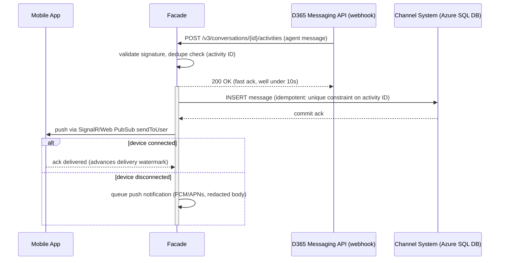
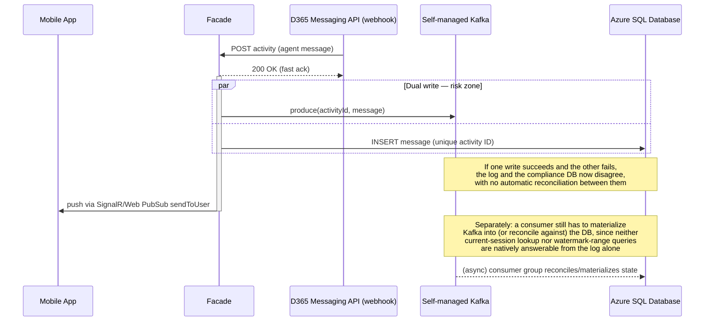
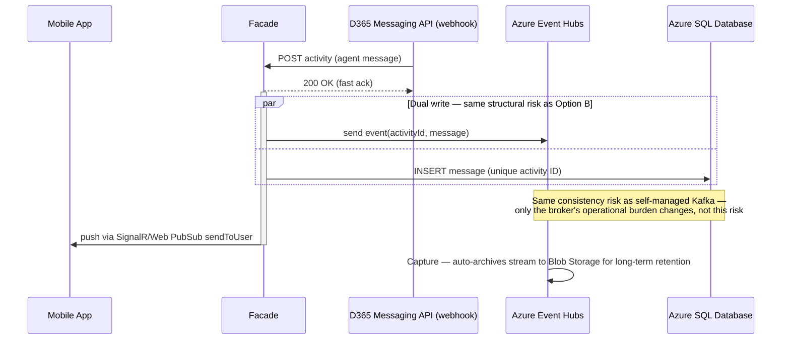
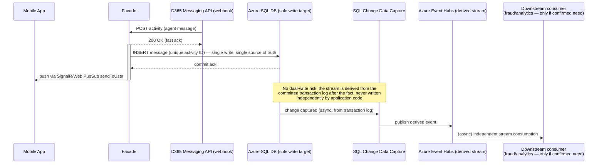

# ADR-0002: Channel System (compliance store) technology

Status: **draft — decision not yet made, needs stakeholder input** (see §7)
Relates to: [chat-facade-architecture-summary.md](./chat-facade-architecture-summary.md), [sd-roadmap.md](./sd-roadmap.md) Phase 2
Decision owner: TBD (backend eng lead + platform/data lead + compliance — confirm in Phase 0)

**Platform constraint (confirmed by the user, supersedes the original summary's suggestion):** PostgreSQL is **not an allowed database technology** at this org. **Microsoft SQL Server (Azure SQL) is the mandated relational database standard.** Every reference to Postgres in the earlier architecture summary's open question is replaced by Azure SQL below.

## 1. Context

The Channel System is the **compliance/audit source of truth** for all human chat interactions — both directions are written here *before* being forwarded downstream (customer message → Channel System → D365; D365 agent message → Channel System → mobile). It needs to support:

- **Durable, idempotent writes** keyed by activity ID (same dedup key used by the webhook and reconciliation paths in the D365 integration).
- **Point/range reads**: "give me the current session for user X," "give me everything since watermark Y for conversation Z" (used by both the mobile catch-up flow and the D365 reconciliation job).
- **Retention** for a regulatory period, with encryption at rest and (per open questions) possibly a specific data-residency region.
- Being the thing compliance/audit actually query when they need chat history — so it needs to be trustworthy as a record, not just fast.

The original architecture summary's open question proposed **"Kafka (or equivalent event log) + Postgres"** without evaluating it against alternatives. This ADR does that evaluation against the org's actual allowed database (Azure SQL, not Postgres) — and, as with ADR-0001, starts by questioning whether the two-system premise is actually justified by the requirements above, or was pattern-matched from a generic "event-sourced system" template without a confirmed need.

## 2. Facts pulled from current Microsoft documentation

(Fetched live — Aug 2026.)

- **Azure Event Hubs** natively supports the Apache Kafka protocol — Microsoft's own docs state this lets you "bring Kafka workloads to Event Hubs without code changes or cluster management, offering better performance and cost efficiency than self-managed Kafka clusters." Also supports **Capture**, which automatically archives stream data to Blob Storage/Data Lake on an interval/size trigger — relevant for long-term retention beyond the hot log's window.
- **Azure SQL Database**: supports **Transparent Data Encryption (TDE)** including bring-your-own-key/customer-managed-key configurations, and **Always Encrypted** for column-level encryption of specific sensitive fields (relevant if certain message fields warrant stronger isolation than table-level TDE). Supports native **Change Tracking** (lightweight row-version tracking) and full **Change Data Capture (CDC)** — `sys.sp_cdc_enable_db` / `sys.sp_cdc_enable_table` work directly on Azure SQL Database, not just SQL Server on-prem or Managed Instance — confirming the "add a stream later via CDC, don't dual-write" pattern from ADR-0001-style reasoning still holds with this engine. Standard T-SQL features apply as normal: unique constraints + `MERGE`/`INSERT ... WHERE NOT EXISTS` for idempotent upsert, native table partitioning.
- **Azure SQL Database vs. Azure SQL Managed Instance**: Managed Instance offers near-100% SQL Server engine surface (SQL Agent jobs, cross-database queries, linked servers, CLR) as PaaS; Azure SQL Database is the lighter-weight, fully-managed single-database PaaS option. Microsoft's own migration guidance: when either target is viable, prefer whichever has the lower estimated cost — i.e., don't default to Managed Instance's fuller feature set unless something specific (e.g. SQL Agent jobs, cross-DB queries) actually requires it. Networking also differs: SQL Database uses IP firewall rules or VNet service endpoints, while Managed Instance requires a private endpoint/dedicated subnet — a factor for the Private Link/VNet-isolation requirement flagged in ADR-0001 §4.4.
- **Regional availability (UAE)**: **Azure SQL Database** and **Azure Event Hubs** are both listed as available in **UAE North and UAE Central** (checked directly against current Azure pricing pages, same caveat as ADR-0001 §2 — UAE Central is access-restricted, confirm subscription-level enablement before relying on it).

## 3. Does this actually need two systems?

Before comparing options, worth naming the risk in the "Kafka + relational DB" premise directly: **if both are written independently on the same request, that's a dual-write** — the write path would need to commit to both an event log and a relational store, and if one succeeds while the other fails, the two diverge. That's exactly the class of failure the summary's own design principle exists to prevent ("write to Channel System first, so a downstream failure never loses the record") — applied recursively, we shouldn't let the Channel System *itself* be internally split into two independently-writable stores that can disagree about what happened. A compliance audit store where the log and the queryable state can drift apart is a worse outcome than a single simpler store.

The requirements in §1 — idempotent keyed writes, point lookups, watermark range queries — are natively **relational** access patterns, not streaming-consumer patterns:
- Idempotent dedup-by-activity-ID is a one-line `UNIQUE` constraint + `MERGE`/conditional insert in T-SQL. In Kafka, producer-side idempotence is keyed by producer-ID/sequence, not by our own activity ID — replicating our dedup semantics on a log still requires a keyed lookup store, i.e., you end up needing the database anyway.
- "Everything since watermark Y for conversation Z" is a trivial indexed range query in SQL. On Kafka, this shape of query (arbitrary per-entity range scan) isn't what the log is good at — you'd model it as one topic per conversation (an anti-pattern at scale — thousands of low-throughput topics) or a shared topic that still gets materialized into an indexed store to actually answer the query, which is the database again.

**This suggests the event log isn't paying for itself against the requirements we actually have today.** It becomes valuable when there's a **confirmed** need for independent downstream consumers to tap the same event stream asynchronously (e.g., a separate fraud-detection service or analytics/data-lake pipeline wanting a real-time feed of chat events without querying our operational database directly). That need isn't stated as confirmed anywhere in the current requirements — same pattern as the connection-lifecycle question in ADR-0001 §6.3, where a "keep the option open for later" justification turned out to be doing a lot of unconfirmed architectural work.

## 4. Options

| Option | Description |
|---|---|
| **A. Azure SQL Database only** (recommended default — see §8) | Azure SQL Database (single database, not Managed Instance — see §2) as the sole source of truth. Append-only `messages` table (insert-only, no update/delete on content rows) for the audit trail + normal relational tables for conversation/watermark/mapping state. |
| **B. Self-managed Kafka + Azure SQL Database** | Original summary's suggestion, adapted to the mandated DB — Kafka run on our own infrastructure (e.g., Strimzi on AKS). |
| **C. Azure Event Hubs (Kafka-compatible) + Azure SQL Database** | Same two-store shape as B, but the log is a managed PaaS service instead of self-hosted. |
| **D. CDC-derived stream off Azure SQL Database** (the way to get B/C's benefit later without the dual-write risk) | Azure SQL Database remains the single write target; a stream (Event Hubs, fed by native CDC — confirmed available on Azure SQL Database, §2) is *derived* from the database's change feed, not written independently. Downstream consumers subscribe to the derived stream; nothing about the source-of-truth write path changes. |

Option D isn't really a competing choice at decision time — it's the answer to "what do we do if/when a streaming-consumer need becomes real," and it's why starting with Option A doesn't foreclose adding a stream later. It avoids ever having two independently-written sources of truth.

## 5. Comparison — complexity and cost

| Dimension | A. Azure SQL DB only | B. Self-managed Kafka + Azure SQL DB | C. Event Hubs + Azure SQL DB |
|---|---|---|---|
| **Build complexity** | Low — one system, one write path, standard T-SQL/ORM patterns the team already knows | High — two write paths (dual-write risk, see §3), Kafka client/consumer-group logic, schema/serialization strategy (Avro/Schema Registry or similar) on top of everything the database already needs | Medium — same dual-write risk as B, but no cluster/broker code to write ourselves; still two write paths and two things that can disagree |
| **Operational complexity** | Low — one managed PaaS to run, patch, monitor, back up | High — cluster sizing, broker patching, partition rebalancing, consumer-group monitoring, on top of database ops | Low-medium — Microsoft's own docs claim Event Hubs removes cluster management vs. self-managed Kafka; still two systems to monitor/alert on instead of one |
| **Cost shape** | Single PaaS bill, well-understood DTU/vCore + storage pricing | Compute for broker nodes (sized for peak throughput/replication factor) + ops engineering time — usually the most expensive option once engineering time is counted | Throughput-unit-based Event Hubs pricing + database — cheaper than self-managed Kafka per Microsoft's stated positioning, still strictly more than Option A |
| **Time-to-market** | Fastest — nothing beyond a well-modeled schema | Slowest — full Kafka build-and-harden cycle | Faster than B, still slower than A (schema + topic design + consumer wiring, even without cluster ops) |

## 6. Quality attributes specific to a compliance/audit store

Beyond complexity and cost, these matter specifically because this is the **regulatory source of truth**, not just an operational cache:

1. **Dual-write / consistency risk** (§3) — the strongest argument against B/C as a *starting* architecture; a single-store design structurally cannot have the log and the state disagree about what happened.
2. **Idempotency fit** — how naturally does the option support "write this activity ID exactly once" without extra machinery? Azure SQL: trivial (unique constraint + `MERGE`). Kafka: needs an auxiliary keyed store anyway.
3. **Query fit** — do the actual required reads (current-session lookup, watermark range, reconciliation diff) map naturally onto the technology, or does the technology require materializing into something else to answer them? Azure SQL: direct fit. Kafka/Event Hubs alone: no.
4. **Immutability / tamper-evidence** — does compliance require proof records weren't altered after the fact (WORM-style guarantee, legal hold)? Neither Azure SQL nor Event Hubs gives this natively; if required, the answer is additive regardless of which option wins here — e.g., periodic export to Azure Blob Storage with an **immutability policy** (time-based retention/legal hold, WORM at the storage layer), which Event Hubs Capture would incidentally also make easy to wire up if a log exists (a point in favor of C *if* this requirement turns out to be real). **This needs a compliance answer — see §7.**
5. **Retention & archival tiering** — regulatory retention is often years, far longer than you want sitting in a hot OLTP database. Azure SQL: table partitioning by time + periodic archive-to-Blob-Storage job. Event Hubs: Capture handles this automatically for anything flowing through the log, which is a genuine convenience if a log exists for other reasons — but isn't itself a reason to introduce one.
6. **Data residency** — same-region requirement as ADR-0001 (§2 there); both Azure SQL Database and Event Hubs are available in UAE North/Central, so this doesn't differentiate the options, just confirms neither blocks a UAE deployment.
7. **Encryption & key management** — Azure SQL supports TDE with customer-managed keys and column-level Always Encrypted for extra-sensitive fields; Event Hubs supports CMK too. Banking environments often want HSM-backed keys (Azure Key Vault Managed HSM) — confirm this is available/required in the target region regardless of which option wins.
8. **Integration with existing platform standards** — if the org already runs Kafka or Event Hubs elsewhere as a platform standard, that changes the calculus toward reuse (shared ops expertise, existing tooling) even if the standalone case for Option A is stronger. This needs a real answer from platform/data teams, not an assumption — **flagged in §7**. (Given the confirmed SQL Server-only constraint on the relational side, it's worth asking the same yes/no question about the messaging/eventing side rather than assuming either way.)

## 7. Open items before this ADR can be finalized

- [ ] Confirm with compliance/legal whether the audit record needs a tamper-evidence/WORM guarantee (feeds §6.4) — if yes, decide where that lives (Blob Storage immutability policy is the likely answer regardless of A vs. C).
- [ ] Confirm exact regulatory retention period (years) — feeds partitioning/archival design either way.
- [ ] Confirm with platform/data engineering whether Kafka or Event Hubs is already a platform standard elsewhere in the org (reuse case) — a real "yes" here is the strongest argument for C over A.
- [ ] Confirm whether any team has a **committed, near-term** need to independently stream/consume chat events (fraud detection, analytics/data lake) — if not confirmed, default to Option A and revisit via the CDC path (Option D) if/when it becomes real, rather than building for it speculatively.
- [ ] Confirm HSM-backed key management requirement and availability in target region.
- [ ] Confirm target subscription has UAE Central access enabled if that's the chosen region (same check as ADR-0001 §7).
- [ ] Confirm expected write volume/throughput to validate Azure SQL Database sizing/tier (ties to the peak-concurrency question already open in ADR-0001 §7 and the roadmap).
- [ ] Confirm Azure SQL Database (not Managed Instance) is the right deployment target — revisit only if a specific need surfaces for SQL Agent jobs, cross-database queries, linked servers, or CLR that Azure SQL Database can't provide (§2).

## 8. Preliminary recommendation

**Option A (Azure SQL Database only, no separate event log)** as the default, pending the open items above — specifically pending compliance's answer on tamper-evidence and platform engineering's answer on existing Kafka/Event Hubs footprint, either of which could shift this toward C. Not B: if a log is ever justified, Microsoft's own stated positioning is that Event Hubs beats self-managed Kafka on both cost and operational effort, so there's no scenario found so far where self-managing a Kafka cluster is the right call for this system. This is a preliminary read, not the final decision — same workshop approach as ADR-0001 §5 recommended here too.

## 9. Sequence diagrams by option

Each diagram shows the **inbound leg** (D365 webhook → facade → Channel System → mobile), since that's where the webhook ack-fast/10s constraint and the dedupe requirement make the Channel-System-write step most visible. The outbound leg (mobile → facade → Channel System → D365) mirrors the same write-to-Channel-System-first shape without the webhook timing constraint, so it isn't redrawn per option.

### Option A — Azure SQL Database only

One write, one commit, one thing that can be "the truth." Nothing else in the picture.

### Option B — Self-managed Kafka + Azure SQL Database

The risk zone is the whole point of drawing this one out — it's the structural problem §3 describes, not a hypothetical.

### Option C — Azure Event Hubs (Kafka-compatible) + Azure SQL Database

Structurally identical risk to Option B; the only thing that changes is who patches the broker.

### Option D — CDC-derived stream off Azure SQL Database

Same customer-facing shape as Option A (top half is identical), with a derived, consistency-safe tail added only if/when §7's streaming-consumer question comes back "yes."

## 10. Decision

*(To be filled in once §7 is resolved and stakeholder input has been gathered.)*
