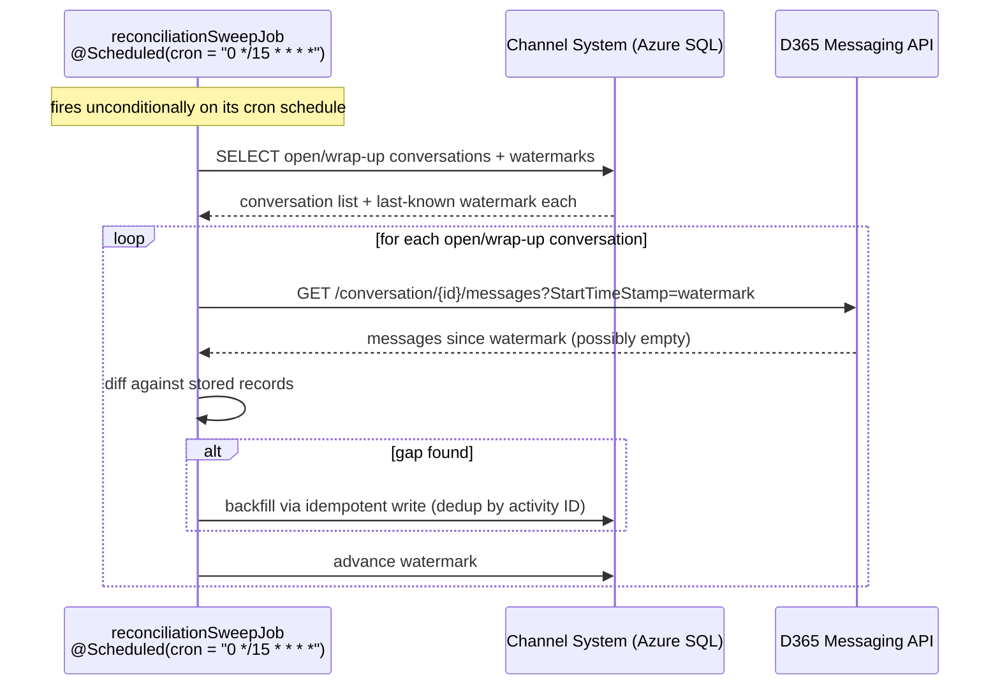
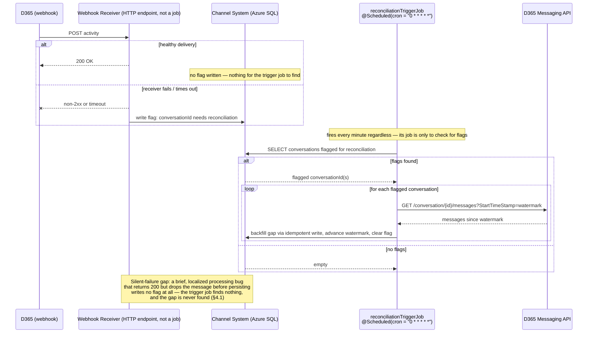

# ADR-0003: Reconciliation job — cadence, trigger model, and scope

Status: **draft — decision not yet made, needs stakeholder input** (see §6)
Relates to: [chat-facade-architecture-summary.md](./chat-facade-architecture-summary.md), [sd-roadmap.md](./sd-roadmap.md) Phase 2
Decision owner: TBD (backend eng lead + compliance — confirm in Phase 0)

## 1. Context

D365's webhook retries an inbound delivery **up to 3 times, 10-second timeout each, then gives up permanently** — no dead-letter queue, no extended retry window on Microsoft's side. The architecture summary already established that the webhook can't be the only inbound path, and proposed a **sparse reconciliation job** as the safety net: track a watermark per open conversation, periodically call the message-history endpoint, diff against what's stored, backfill gaps through the same idempotent write path as the webhook.

What wasn't decided: **how often**, **what triggers a run beyond the fixed interval**, and **which conversations are in scope**. That's this ADR.

## 2. Facts pulled from current Microsoft documentation

(Fetched live — Aug 2026, against the Dynamics 365 Contact Center / Messaging API reference — this API surface was a preview feature at the time of the original summary, so these details were worth re-checking rather than assuming.)

- **The "don't poll" warning is on a specific endpoint, not the reconciliation endpoint we'd actually use.** `GET /api/v1.0/consumer/conversations` (lists *all* active conversations) carries an explicit warning in Microsoft's docs: *"Do not use as a polling mechanism; use conversation events and webhooks for updates."* This is a **different endpoint** from the one the reconciliation job needs — `GET /api/v1.0/consumer/conversation/{conversationId}/messages` (history for *one specific* conversation) — which carries no such warning in the current docs. This matters: it confirms the summary's original design (only ever query conversations *we already know about* from our own state, never ask D365 "what's open") is the correct way to stay inside Microsoft's guidance, not just a cautious guess.
- **The per-conversation messages endpoint supports incremental fetch**: `StartTimeStamp`, `PageSize` (default 50, max 250), and `ContinuationToken` are documented query parameters on the messages endpoint. This means reconciliation doesn't need to re-fetch a conversation's entire history each run — it can pass the stored watermark as `StartTimeStamp` and only pull what's new, which reduces both payload size and how much this looks like "polling" from Microsoft's perspective.
- **The webhook stream includes explicit lifecycle events** — `ConversationClosed` and `AgentClosed` — delivered the same way as any other activity. This is the primary signal for shrinking the reconciliation job's scope (a conversation leaves the "needs reconciling" set once one of these arrives) — but it's subject to the exact same 3-retry/10s loss risk as any other webhook delivery, so it can't be trusted as the *only* way a conversation exits scope (§4.4).
- **No documented numeric rate limit** for the per-conversation messages endpoint surfaced in the current docs. This directly bounds how aggressive the cadence can be (interval × concurrent open conversations = call volume) and needs a direct answer from Microsoft or empirical testing in a sandbox tenant before committing to a production interval — **flagged in §6**, not assumed.
- **Webhook retry behavior confirmed as stated in the original summary**: 3 attempts, 10-second timeout each, then permanent give-up, with no signal sent back to us about whether a delivery ultimately succeeded or was abandoned.

## 3. The core design constraint: D365 never tells us it gave up

This shapes what "triggered" can mean here. Because Microsoft's service doesn't notify us when its 3 retries are exhausted, we cannot build a trigger keyed on "D365 says this delivery failed" — that signal doesn't exist. The only failure signals available to us are **our own**:
- Our webhook receiver returning non-2xx or timing out on a specific delivery attempt (observable in our own request logs/metrics in real time).
- Broader infra health-check failures (receiver down, deploy window, dependency outage).
- A conversation sitting in `open`/`wrap-up` in our own state for an implausibly long time with no activity — plausible evidence its `ConversationClosed`/`AgentClosed` event was itself lost (§2), not just evidence of a slow conversation.

Any cadence/trigger design has to be built around these three signals, not around anything D365 reports about its own retry outcome.

## 4. Design axes and options

### 4.1 Cadence: fixed interval only vs. triggered only vs. hybrid

| Option | Description | Assessment |
|---|---|---|
| **A. Fixed interval only** | Reconcile every open/wrap-up conversation every N minutes, regardless of any health signal | Simple, but blind to both directions of risk: doesn't tighten up during a known local outage, and keeps polling at full rate even when there's no reason to suspect any gap |
| **B. Triggered only** (on local failure signals from §3) | No baseline sweep; only reconcile when a failure signal fires | Minimizes steady-state API load, but misses the "silent" case: a brief, localized failure (e.g. one payload triggers a processing bug) that doesn't register on infra health checks and produces no local failure signal at all |
| **C. Hybrid — sparse fixed interval + immediate trigger on local failure signals** (recommended, see §7) | Baseline sweep at a conservative interval for all in-scope conversations, **plus** an out-of-band immediate run scoped to the affected conversation(s) the moment a local failure signal (§3) fires | Bounds worst-case staleness to the fixed interval even in the fully-silent-failure case, while collapsing staleness to near-zero for any failure we can actually observe locally — closes both gaps A and B leave open |

### 4.2 Scope: which conversations get reconciled

Reconciliation must iterate **our own internally tracked set of `open`/`wrap-up` conversations** (from the Channel System's conversation-state table) — never D365's conversation-list endpoint, per §2. This is bounded by actual concurrent chat volume, not total historical volume, which also keeps call volume proportionate regardless of which cadence option is chosen.

**Edge case worth designing for explicitly:** if a conversation's `ConversationClosed`/`AgentClosed` webhook event is itself lost (§2), our internal state never learns it closed, and the conversation stays in reconciliation scope indefinitely. Recommend a **stale-open escalation**: if a conversation has been `open`/`wrap-up` in our state for longer than some threshold (e.g. a multiple of typical conversation duration) with no new activity found on the last several reconciliation passes, alert for investigation rather than silently reconciling it forever. This is a correctness/observability detail the original summary's design didn't cover.

**Not a real risk for conversation *existence*, only for conversation *closure*:** because *we* initiate every conversation (`POST /chat/sessions` → D365), we always know a conversation exists the moment we create it — there's no scenario where reconciliation needs to discover a conversation we never knew about, unlike the closure-event-loss case above. Worth confirming the create-conversation call returns the `conversationId` synchronously in its response (expected, but not re-verified in this pass — **flagged in §6**) so this assumption actually holds.

## 5. Quality attributes for this decision

1. **Worst-case staleness bound** — the number compliance actually needs an answer on (roadmap §4.3's open question). Under Option C, worst case = the fixed-interval value, for the narrow case of a fully silent failure; realistically much lower whenever a local failure signal exists to trigger an immediate run. Whatever interval is chosen becomes the de facto compliance-facing SLA for "how stale can the record be" — it should be picked and stated as that, not left implicit.
2. **API load / undocumented-rate-limit risk** — interval × concurrent open conversations is the real load figure; without a confirmed rate limit (§2) this needs sandbox validation before committing to a number, not just a guess that "sparse" is safe.
3. **False sense of coverage from lifecycle events** — treating `ConversationClosed`/`AgentClosed` as authoritative-and-only would silently under-scope the job over time (§4.2); the stale-open escalation exists specifically to catch this.
4. **Operational alerting** — a triggered run firing repeatedly is itself a signal (sustained webhook receiver trouble) and should feed the same alerting strategy the roadmap already flags as an open item (webhook-down, reconciliation-finding-gaps, etc.) rather than being a silent background process.
5. **Idempotency reuse** — this job must write through the exact same dedup-by-activity-ID path as the webhook receiver (already established in the summary); this ADR doesn't change that, just when/how often the job runs.

## 6. Open items before this ADR can be finalized

- [ ] **Confirm acceptable staleness window with compliance** — this decision proposes treating the fixed-interval value as that SLA; compliance needs to confirm a number (or confirm the proposed default in §7) rather than this being an engineering-only judgment call.
- [ ] Confirm the actual rate limit (if any) for `GET /api/v1.0/consumer/conversation/{conversationId}/messages` directly with Microsoft, or empirically via sandbox load testing, before committing to a production interval.
- [ ] Confirm that starting a conversation via the Messaging API returns `conversationId` synchronously in the response (feeds §4.2's "no discovery risk" claim).
- [ ] Decide the stale-open escalation threshold (§4.2) and who gets paged when it fires.
- [ ] Confirm this job's alerting hooks into the broader failure/alerting strategy (roadmap §4.6 open item) rather than being designed in isolation.

## 7. Preliminary recommendation

**Option C (hybrid)**: baseline sweep every **15 minutes** (starting point, pending §6's rate-limit and compliance-staleness confirmation — not a final number) over the internally-tracked `open`/`wrap-up` conversation set, using `StartTimeStamp`-based incremental fetch (§2) rather than full-history re-pull each time; plus an immediate, conversation-scoped reconciliation run triggered the moment a local delivery failure or health-check failure is observed (§3). Add the stale-open escalation (§4.2) as a correctness backstop rather than treating webhook-delivered close events as fully reliable. This is a preliminary read pending the open items in §6, not a final decision.

## 8. Sequence diagrams by option

**Implementation constraint (confirmed):** every job in this design is a **Spring `@Scheduled` cron-triggered bean** — there is no message queue or event bus in the picture. This has a direct consequence for the "triggered" path in Options B and C: since nothing can push a job into action outside of its own cron tick, a "trigger" can't be a live call from the webhook receiver into the reconciliation job. Instead, the webhook receiver's only job on failure is to **write a flag** (a row/column marking "this conversation needs reconciliation") — a second, short-interval cron job is the thing that actually notices the flag and acts on it. Two cron beans, different schedules and scope, both landing on the same underlying fetch/diff/backfill logic.

### Option A — Fixed interval only



One bean, one cron expression, full scope every tick — no way to tighten up in response to a known problem (§4.1).

### Option B — Triggered only



The trigger job itself still runs on a cron tick (that's the constraint) — what makes this "triggered" rather than "fixed interval" is that it does almost nothing on most ticks (empty flag table) and only does real work when the receiver actually flagged something. The blind spot is drawn deliberately — it's the reason this option isn't recommended alone.

### Option C — Hybrid (recommended)

```mermaid
sequenceDiagram
    participant D365w as D365 (webhook)
    participant Receiver as Webhook Receiver
    participant DB as Channel System (Azure SQL)
    participant Sweep as reconciliationSweepJob<br/>@Scheduled(cron = "0 */15 * * * *")
    participant Trigger as reconciliationTriggerJob<br/>@Scheduled(cron = "0 * * * * *")
    participant D365 as D365 Messaging API

    D365w->>Receiver: POST activity
    Receiver--xD365w: delivery fails locally
    Receiver->>DB: write flag: conversationId needs reconciliation

    par Sweep — every 15 min, full scope
        Sweep->>DB: SELECT all open/wrap-up conversations + watermarks
        loop for each conversation
            Sweep->>D365: GET messages since watermark
            Sweep->>DB: diff + backfill + advance watermark
        end
    and Trigger — every 1 min, flagged scope only
        Trigger->>DB: SELECT conversations flagged for reconciliation
        loop for each flagged conversation
            Trigger->>D365: GET messages since watermark
            Trigger->>DB: diff + backfill + advance watermark + clear flag
        end
    end

    Note over Sweep,Trigger: Two cron beans, same underlying reconcile(conversationId)<br/>logic, different schedule and scope. Sweep bounds worst-case<br/>staleness to 15 min even for the silent-failure case Trigger<br/>alone would miss; Trigger collapses staleness to ~1 min<br/>for anything the receiver actually observed locally.
```

Both beans call the same reconciliation logic with different inputs (all-open vs. flagged-only) — the hybrid isn't a third implementation, it's Option A's bean plus Option B's bean running side by side, which is why the recommendation in §7 costs almost nothing extra to build once both exist independently. Exact cron expressions above are illustrative, matching the 15-minute starting point from §7 — not final (§6).

## 9. Decision

*(To be filled in once §6 is resolved.)*
