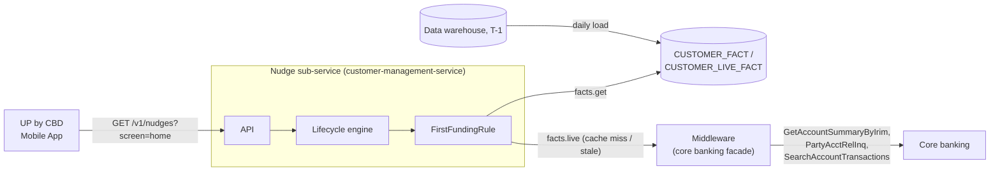

# 1. Introduction

**Feature.** Enable newly onboarded SME customers to discover and adopt key **Up by CBD** capabilities through contextual, progress-based nudges. The activation journey prioritizes essential actions in order: **account funding** → payment initiation → other relevant banking services. This document covers the first and currently scoped step only: the **Fund the Account** nudge (`first_funding` in the nudge data model). Payment initiation and further service nudges are future backlog items, to be designed as separate features placed on their own screens once this nudge is live.

This feature is an instance of the use case already described in `nudges-model.md` §7.1 ("First funding after onboarding"). No changes to the shared data model are required; this document maps the feature's specific requirements (role gating, multi-account aggregation, middleware calls) onto the existing model and flags where the model needs a decision to fully cover them.

**Ownership.**

| Concern | Owner |
|---|---|
| Nudge decision (`first_funding` rule, lifecycle, caching) | Nudge sub-service (`customer-management-service` / Kevlar) |
| Warehouse fact (`incoming_transaction_count`, T-1) | Data platform |
| Live account/transaction data (balance, credit transactions) | Middleware (core banking facade) — consumed by the nudge sub-service's live lookup, not a new integration |
| User role (OWNER / non-OWNER) within the company | Identity/session — authorization, not a customer fact (see §3, Decisions) |
| Presentation of the nudge on the dashboard | UP by CBD mobile app |

The nudge sub-service remains the **only writer** of nudge state (`CUSTOMER_NUDGE`, `CUSTOMER_NUDGE_HISTORY`, `CUSTOMER_LIVE_FACT`). Middleware and the data platform are read-only inputs to the rule; this feature introduces no new writers.

# 2. Architecture

## C2 diagram container diagram



Nothing new is added to the shared instance or schemas described in `nudges-model.md` §3–4: this feature is one rule class (`FirstFundingRule`) plus its live-lookup implementation against existing middleware endpoints.

## Sequence diagram

The flow below replaces the draft in `Feature-2.txt` with the model's existing public contract (`GET /v1/nudges?screen=home`, §6.1) and existing lifecycle engine (§5.1). Simplification agreed: **drop the `onboarded_at` / Profile API check entirely.** A new warehouse fact, `incoming_transaction_count`, lets the rule complete for free whenever the data platform already knows the company has been funded; only when that fact is absent or still zero does the rule fall back to the live balance/transaction check against middleware — matching the draft's per-account loop, but now only reached when the cheap warehouse signal can't already answer the question.

::: mermaid
sequenceDiagram
autonumber
participant front as UP by CBD<br>Mobile App
participant api as Nudge Sub-Service API
participant eng as Lifecycle Engine
participant rule as FirstFundingRule
participant mw as Middleware

Note left of front: Dashboard opened, session established

front ->> api: GET /v1/nudges?screen=home

opt session role is not OWNER
    api -->> front: nudges: []
end

api ->> eng: evaluate(company_rim, first_funding, now)

alt cached ELIGIBLE/terminal row, not expired
    eng -->> api: cached decision
else evaluation needed
    eng ->> rule: evaluate(facts, state, now)

    rule ->> rule: facts.get("incoming_transaction_count")
    opt warehouse fact present and > 0
        rule -->> eng: Complete
    end

    rule ->> mw: GetAccountSummaryByIrim(company_rim)
    mw -->> rule: accounts for company_rim

    loop for each account, until one qualifies
        rule ->> mw: PartyAcctRelInq (balance)
        mw -->> rule: available balance
        opt balance != 0
            rule -->> eng: Complete
        end
        rule ->> mw: SearchAccountTransactions [filter=CREDIT]
        mw -->> rule: credit transactions
        opt any credit transaction found
            rule -->> eng: Complete
        end
    end

    rule -->> eng: Eligible(ttl=15m) | Complete
    eng ->> eng: upsert CUSTOMER_NUDGE, CUSTOMER_LIVE_FACT, CUSTOMER_NUDGE_HISTORY
    eng -->> api: decision
end

api -->> front: nudges: [{ "name": "first_funding" }] | []
:::

**Rule.**

```
FirstFundingRule
    name   = "first_funding"
    policy = { max_attempts: none }

    evaluate(facts, state, now):
        count = facts.get("incoming_transaction_count")
        if count exists and count > 0:                                 return Complete

        if facts.live("first_transaction_at", ttl = 15 min) exists:    return Complete

        return Eligible(ttl = 15 min)
```

The per-account loop (balance, then credit transactions, breaking on the first account that qualifies) is the **implementation of the `first_transaction_at` live lookup**, not something the rule itself sees — same pattern as the model's own §7.1 example. This matters for persistence: `first_transaction_at` is a `once` fact, so per the `facts.live` contract (§4.3), the moment the lookup finds a non-zero balance or a credit transaction on *any* account, the engine writes that result into `CUSTOMER_LIVE_FACT` **permanently**, not just for the 15-minute `ttl`. Combined with `CUSTOMER_NUDGE.status` becoming `COMPLETED` (terminal), the engine's `evaluate()` (§5.1) short-circuits on every future call — `if row.status is terminal: return row` — before the rule or any middleware call ever runs again for that customer. So funding is discovered live at most once: after that, the nudge is gone for good, with no repeated `PartyAcctRelInq` / `SearchAccountTransactions` calls.

There is no `Expire` branch anymore: without `onboarded_at`, the rule has no notion of "too long since onboarding." See Decisions item 7 below.

# 3. Design & Implementation

## User Journey

_(link to figma — TBD)_

Scope for this iteration: the `first_funding` nudge on the `home` screen only, shown to OWNER-role users of a newly onboarded company with no funded account. Payment-initiation and other activation nudges referenced in the feature description are out of scope here and will get their own placements/rules later, reusing the same engine.

## Backlog

### Features

#TBD — Fund the Account nudge (`first_funding`)

### Decisions

Open items that need a decision before/during implementation, in addition to the model's existing open decisions (`nudges-model.md` §9):

1. **Role gating is not a customer fact.** The draft checks "User Role is Not OWNER" per request. `company_rim` identifies the company, not the acting user, and the model has no concept of per-user roles within a company. Proposal: enforce this at the API/controller layer from the authenticated session, before the engine is invoked at all — it is an authorization concern, not an input to `FirstFundingRule`, and it should apply uniformly to every nudge placed on screens an OWNER-only user can't act on, not be duplicated per rule.
2. **Multi-account aggregation semantics.** "Funded" is proposed as *any* account under the company's `company_rim` having a non-zero balance or a credit transaction — matching the draft's `break` behavior. Confirm this is correct for companies with multiple account types/currencies.
3. **Live lookup capability** (reuses model open decision §9.2): can `PartyAcctRelInq` / `SearchAccountTransactions` answer "ever had a credit transaction," or only "current balance / transactions in a bounded window"? This determines whether `Eligible(ttl=15m)` is safe or whether a deposit-then-withdrawal between polling windows can be missed until `incoming_transaction_count` catches it the next day.
4. **Cache TTL** (reuses model open decision §9.1): 15 minutes proposed, per account-loop cost vs. staleness tradeoff already discussed in the model.
5. **Terminology reconciliation.** The draft's middleware calls use `Irim`; confirm this is the same identifier as `company_rim` used throughout the nudge model, or that a mapping step exists.
6. **`nps_feedback_submitted` reference in the draft.** `Feature-2.txt` mentions establishing a live `nps_feedback_submitted` fact, but the attached sequence diagram only covers funding checks. Clarify with the author whether an NPS/CSAT-style nudge (parallel to the `csat_survey` use case in model §7.2) is a separate, not-yet-drafted feature, or whether it was meant to be folded into this one.
7. **No expiry without `onboarded_at`.** Dropping the Profile API check removes the rule's only basis for ever stopping the nudge besides funding (the model's §7.1 example expires after 30 days). As designed, a company that never funds sees `first_funding` as `ELIGIBLE` indefinitely. Confirm whether that's acceptable, or whether a different signal (e.g. `account_open_date` from the warehouse, or an app-side display cap via `policy.max_attempts`) should still cap how long it's shown.
8. **`incoming_transaction_count` fact shape.** Proposed as a data-platform warehouse fact (`owner: data_platform`, `source: dwh`, `kind: snapshot`), even though in practice it only moves in one direction (0 → positive) for this rule's purposes. Confirm with the data platform team that this is a new `FACT_DEFINITION` row, not a reinterpretation of an existing fact.

### Tests

_(link to test suite — TBD)_

- `FirstFundingRule` unit tests built from fact fixtures (model guideline §4.3.3): `incoming_transaction_count > 0` → `Complete` (no middleware calls expected); fact absent, all accounts zero balance and no credits → `Eligible`.
- Multi-account fixture: `incoming_transaction_count` absent, one of several accounts has a non-zero balance → `Complete` without reaching the transaction-history call for that account; one account has a credit transaction with zero balance → `Complete`; all accounts zero balance, no credits → `Eligible`.
- Role filter: non-OWNER session → empty nudges, regardless of underlying facts.
- Middleware failure on any call in the loop → `PENDING_CHECK`, retried on next request (no partial/incorrect decision cached).
- Cache behavior: second request within 15 minutes returns the cached decision without re-invoking middleware.
- Long-lived never-funded company: confirm current expected behavior is indefinite `ELIGIBLE` (see Decisions item 7) rather than an accidental `Expire`.

## API definition

_(link to swagger — TBD)_

No new endpoint. Uses the existing contract from `nudges-model.md` §6.1:

```
GET /v1/nudges?screen=home
```

```json
{
  "screen": "home",
  "nudges": [
    { "name": "first_funding" }
  ]
}
```

The `GetAccountSummaryByIrim`, `PartyAcctRelInq`, and `SearchAccountTransactions` middleware calls in the sequence diagram are internal to the `first_funding` live lookup implementation and are not part of the public nudge API.
