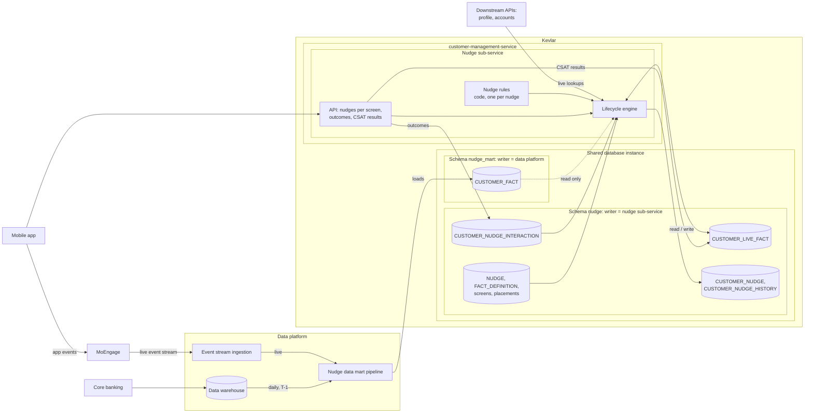
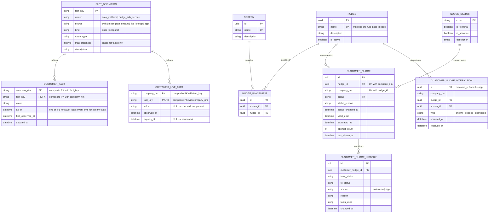
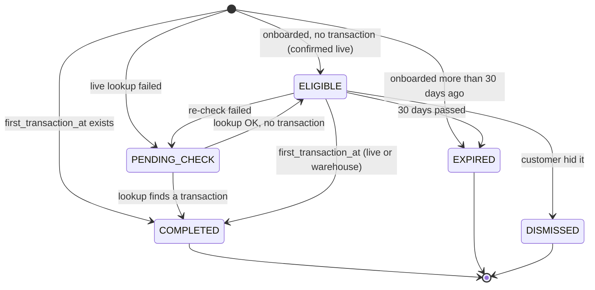
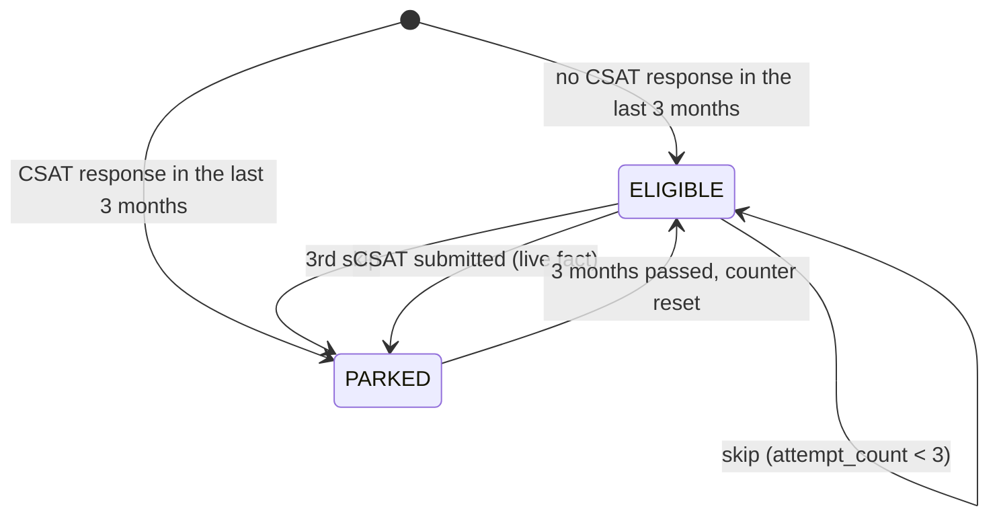

# Nudges: data model and use cases

> Status: draft for discussion, v2.5 (customer facts separated from nudge decisions; shared database instance in Kevlar; CSAT results as live facts; MoEngage event stream as a fact source; business rules in code; customer identified by `company_rim`)
> Scope: backend model for deciding which nudges a customer should see, served to the mobile app per screen.

## 1. Summary

A **nudge** is a backend-driven signal telling the mobile app that a customer should be prompted to take a specific action (for example, fund a new account or rate the app). The backend decides **which** nudges are active for a customer on a given screen. The mobile app decides **what** the nudge looks like and **how** it is presented.

Nudges are handled by the **nudge sub-service** of `customer-management-service`, part of **Kevlar**.

Throughout this document, **customer** means the SME (the company), identified by `company_rim`.

The model separates two concerns with different owners:

| Concern | Question it answers | Owner |
|---|---|---|
| **Customer facts** | What is true about the customer? | Data platform (warehouse and stream facts); nudge sub-service (live facts) |
| **Nudge decisions** | Given those facts, which nudge should the customer see, and in what state is it? | Nudge sub-service only |

The data platform knows nothing about nudges. It publishes facts such as "onboarded at", "first transaction at" or "belongs to segment X". The nudge sub-service decides what to do with those facts and is the **only writer** of nudge state.

**Business rules live in code.** Each nudge has one small rule class that turns facts into a decision. A shared lifecycle engine applies that decision: it caches it, handles skips and parking, protects terminal statuses and records history. The database holds only what must change without a deployment: which nudges exist, whether they are active, and on which screens they appear.

There is no asynchronous communication between services. Inputs reach the nudge sub-service in only three ways:

1. **Facts from the data platform**, from two sources: daily T-1 loads from the data warehouse, and facts derived from the live stream of app events the mobile app sends to MoEngage.
2. **Synchronous calls**: from the mobile app (nudge requests, outcomes, CSAT results), and from the nudge sub-service to downstream APIs (live lookups).
3. **Time**: `valid_until` passing.

## 2. Key principles

1. **One table, one writer.** Every table has exactly one system that writes to it. Other systems may only read it.
2. **The data platform says what is true; the nudge sub-service decides what to do about it.** Facts are nudge-agnostic and reusable.
3. **Business rules are code; the lifecycle is shared.** A rule class decides *what* the outcome is for one nudge. The engine decides *how* statuses change, the same way for every nudge.
4. **Nudge state is a projection.** `CUSTOMER_NUDGE` is derived from rules, facts and interactions. It is stored for speed and auditability, and can be rebuilt from its inputs.
5. **Historical data (T-1) can only say "never", not "show today".** Facts that have already happened (for example, the first transaction) never stop being true, so they can safely close a nudge forever. Whether a nudge should be shown *today* may require a live lookup.
6. **Terminal statuses are final.** The engine never changes a row once it is in a terminal status.
7. **The backend returns only nudge names per screen.** Presentation belongs to the mobile app.
8. **State is per customer and nudge, not per screen.** Skipping a nudge on one screen counts for every screen it is placed on.
9. **Every status change is recorded with its reason**, so the question "why did / didn't this customer see the nudge?" can always be answered.

## 3. Ownership overview

The data platform has two sources:

- **Data warehouse (T-1):** core banking data, available the next day.
- **MoEngage event stream (live):** the mobile app sends events to MoEngage, which streams them live into the data platform. This stream contains only what the app reports (customer actions in the app). It does not contain core banking postings such as incoming transfers from other banks.

The data platform builds a **nudge data mart** with customer facts from both sources. The mart lives in **Kevlar**, on the same database instance as the nudge sub-service's own tables, in a separate schema. Sharing the instance makes reads cheap; separate schemas and database roles keep ownership separate.



| Table | Schema | Single writer | Readers |
|---|---|---|---|
| `CUSTOMER_FACT` | `nudge_mart` | Data platform (daily load from the data warehouse; continuous load from the MoEngage stream) | Nudge sub-service |
| `FACT_DEFINITION` | `nudge` | Nudge sub-service (catalogue; changes reviewed with the data platform) | Both |
| `CUSTOMER_LIVE_FACT` | `nudge` | Nudge sub-service (live lookups, CSAT results) | Nudge sub-service |
| `NUDGE`, `SCREEN`, `NUDGE_PLACEMENT` | `nudge` | Nudge sub-service (configuration) | Nudge sub-service |
| `CUSTOMER_NUDGE_INTERACTION` | `nudge` | Nudge sub-service (app outcomes) | Nudge sub-service, data platform (analytics) |
| `CUSTOMER_NUDGE`, `CUSTOMER_NUDGE_HISTORY` | `nudge` | Nudge sub-service (lifecycle engine) | Nudge sub-service, data platform (analytics) |

### 3.1 Rules for the shared instance

1. **Ownership is enforced by database roles, not by convention.** The data platform role can write only to `nudge_mart` and read `nudge` (for analytics). The `customer-management-service` role can write only to `nudge` and read `nudge_mart`.
2. **No foreign keys across schemas.** `CUSTOMER_FACT.fact_key` refers to `FACT_DEFINITION` logically only. A foreign key would couple the two teams' deployments; the mart pipeline validates fact keys in its tests instead.
3. **Loads are atomic.** The daily load goes into a staging table and is swapped in within one transaction (or upserted in one transaction), so the engine never reads half a load. Stream-derived facts are upserted per customer in small transactions.
4. **The daily load runs off-peak.** The instance also serves the API, so the daily load runs outside peak hours in the UAE. Its write volume, and the continuous stream writes, are monitored against API latency.

## 4. Data model



The customer is a **company**, identified by `company_rim` (the company's RIM in core banking). All facts and all nudge state are kept per company. `company_rim` is stored as a string, because core banking identifiers may contain leading zeros.

### 4.1 Facts

| Table | Purpose |
|---|---|
| `FACT_DEFINITION` | Catalogue of facts the nudge sub-service consumes: owner, source, kind, value type, staleness limit. This is the contract between the data platform and the nudge sub-service. |
| `CUSTOMER_FACT` | Facts loaded by the data platform into the nudge data mart (schema `nudge_mart`): daily from the data warehouse (T-1), and continuously from the MoEngage event stream. Nudge-agnostic. |
| `CUSTOMER_LIVE_FACT` | Facts the nudge sub-service observes itself, from two sources: live lookups calling downstream APIs, and CSAT results submitted by the app. |

**Shape of the fact tables.** `FACT_DEFINITION` has one row per *type* of fact. `CUSTOMER_FACT` and `CUSTOMER_LIVE_FACT` have one row per customer **and** fact type: the primary key is composite (`company_rim`, `fact_key`). A customer therefore has as many rows as there are facts known about them:

| company_rim | fact_key | value | as_of |
|---|---|---|---|
| `000123` | `onboarded_at` | `2026-11-02T06:00Z` | `2026-11-02T23:59Z` |
| `000123` | `first_login_at` | `2026-11-02T06:10Z` | `2026-11-02T06:10Z` |
| `000123` | `first_transaction_at` | `2026-11-03T10:20Z` | `2026-11-03T23:59Z` |
| `000123` | `account_type` | `SME_BASIC` | `2026-11-03T23:59Z` |
| `000123` | `segment.invoicing_candidate` | `false` | `2026-11-03T23:59Z` |
| `000456` | `onboarded_at` | `2026-10-15T08:30Z` | `2026-11-03T23:59Z` |

This narrow, key-value shape means a new fact needs only a new `FACT_DEFINITION` row, not a schema migration. The cost is that `value` is stored as text and interpreted using `FACT_DEFINITION.value_type`. Each table keeps only the **latest** value per customer and fact; history of a fact, if needed, is kept in the data warehouse.

**Fact kinds.**

| Kind | Meaning | Contract | Example |
|---|---|---|---|
| `once` | Something that happened at least once. | Once present, never removed or changed. | `onboarded_at`, `first_transaction_at`, `first_invoice_at` |
| `snapshot` | The current or latest value, which may change. | Data platform snapshots are ignored when `as_of` is older than `max_staleness` (for example, after a failed load). | `account_type`, `segment.invoicing_candidate`, `csat.last_response_at` |

**Fact sources and their latency.**

| Source | Writer | Latency | Covers |
|---|---|---|---|
| `dwh` | Data platform | T-1 | Core banking data: accounts, transactions, customer profile, derived segments |
| `moengage_stream` | Data platform | Near real time (to be confirmed) | Only events the mobile app sends to MoEngage, i.e. actions taken in the app |
| `live_lookup` | Nudge sub-service | At request time | Selected facts read from downstream APIs (profile, accounts), on demand from a rule |
| `app` | Nudge sub-service | At request time | Data the app submits directly to the sub-service (CSAT results) |

**Example facts.**

| fact_key | owner | source | kind | Live lookup in code | Example value |
|---|---|---|---|---|---|
| `onboarded_at` | data_platform | dwh | once | profile API | `2026-11-02T06:00Z` |
| `first_transaction_at` | data_platform | dwh | once | accounts API | `2026-11-03T10:20Z` |
| `first_invoice_at` | data_platform | dwh | once | — | `NULL` |
| `account_type` | data_platform | dwh | snapshot | — | `SME_BASIC` |
| `segment.invoicing_candidate` | data_platform | dwh | snapshot | — | `true` |
| `app.last_session_at` (illustrative) | data_platform | moengage_stream | snapshot | — | `2026-11-02T10:05Z` |
| `csat.last_response_at` | nudge_sub_service | app | snapshot | — | `2026-11-02T10:15Z` |
| `csat.last_score` | nudge_sub_service | app | snapshot | — | `4` |

A fact with a live lookup keeps its `source` (for example `dwh`); the lookup is an additional, faster way to learn it, and its result is stored in `CUSTOMER_LIVE_FACT`.

The MoEngage stream lowers latency only for facts about **in-app actions**. Facts that originate in core banking (for example, an incoming transfer from another bank) still arrive T-1, so first funding keeps its live lookup.

Complex logic (for example, "at least 5 incoming transfers in the last 30 days") stays in the data platform and is published as a `segment.*` fact. The rule in code only checks membership.

### 4.2 Nudge configuration (database)

Only what may need to change without a deployment is kept in the database.

| Table | Purpose |
|---|---|
| `NUDGE` | Catalogue of nudges. `name` is the contract with the mobile app and matches a rule class in code. `is_active` is the off switch. |
| `SCREEN` | App screens that can display nudges. `name` is the contract with the mobile app. |
| `NUDGE_PLACEMENT` | Which nudges may appear on which screens. |

Consistency between the database and the code:

- A `NUDGE` row with no matching rule class is never served and raises an alert.
- A rule class with no `NUDGE` row is never served.
- Adding a nudge means: a rule class with its tests, a `NUDGE` row, and placements.

### 4.3 Nudge rules (code)

Each nudge has one rule class. The shared lifecycle engine calls it and applies the result.

```
interface NudgeRule
    name:   string                  -- matches NUDGE.name
    policy: NudgePolicy             -- applied by the engine, not by the rule
    evaluate(facts, state, now) -> Decision

NudgePolicy
    max_attempts:  int or none      -- skips allowed before parking
    park_duration: duration         -- pause after max_attempts skips
    min_interval:  duration or none -- minimum time between two showings
```

**Decisions a rule can return.**

| Decision | Meaning | Resulting status |
|---|---|---|
| `Exclude` | The customer can never qualify. | `EXCLUDED` (terminal) |
| `Complete` | The goal of the nudge is achieved for good. | `COMPLETED` (terminal) |
| `Expire` | The nudge's time window has passed. | `EXPIRED` (terminal) |
| `Park(until)` | Pause until the given time. | `PARKED` |
| `NotEligible` | Not now, but may change. | `NOT_ELIGIBLE` |
| `Eligible(ttl)` | Show it; re-evaluate after `ttl`. | `ELIGIBLE`, `valid_until = now + ttl` |

**What a rule can read.**

- `facts.get(key)` returns the value from `CUSTOMER_FACT` or `CUSTOMER_LIVE_FACT`, whichever is fresher. Stale snapshots (older than `max_staleness`) are returned as missing.
- `facts.live(key, ttl)` performs the live lookup defined in code for that fact and stores the result in `CUSTOMER_LIVE_FACT`. A positive result for a `once` fact is stored permanently; any other result expires after `ttl`. If the lookup fails, the engine records `PENDING_CHECK`.
- `state` is the current `CUSTOMER_NUDGE` row (read-only).

**Guidelines for rule code.**

1. A rule only decides. It never writes state, history or facts directly; `facts.live` is the only side effect, and it goes through the engine.
2. A rule does not implement skips, parking after skips, caching or terminal protection. Those belong to the engine.
3. Every rule has unit tests built from fact fixtures (for example, "onboarded yesterday, no transaction → `Eligible`").

### 4.4 Customer state

| Table | Purpose |
|---|---|
| `CUSTOMER_NUDGE_INTERACTION` | Append-only log of what the customer did with a nudge, as reported by the app (`shown`, `skipped`, `dismissed`). Its `id` (the app's `outcome_id`) makes writes idempotent. |
| `CUSTOMER_NUDGE` | Current state of one nudge for one customer (the projection). Unique on (`nudge_id`, `company_rim`). |
| `CUSTOMER_NUDGE_HISTORY` | Log of status transitions, with the source, the reason and the facts used. |

### 4.5 Status dictionary (`NUDGE_STATUS`)

| Code | Terminal | Servable | Meaning |
|---|---|---|---|
| `ELIGIBLE` | no | **yes** | Served to the app until `valid_until`, then re-evaluated. |
| `NOT_ELIGIBLE` | no | no | Not now, but may change (for example, a segment change or `min_interval` not yet passed). |
| `PENDING_CHECK` | no | no | Undecided: a live lookup failed or was unavailable. Retried on the next request. |
| `PARKED` | no | no | Paused until `valid_until` (after too many skips, or by the rule), then evaluated again. |
| `COMPLETED` | **yes** | no | Goal achieved; never shown again. |
| `EXCLUDED` | **yes** | no | The customer will never qualify. |
| `EXPIRED` | **yes** | no | The nudge's time window has passed. |
| `DISMISSED` | **yes** | no | The customer permanently hid the nudge. |

### 4.6 What drives each transition

All transitions are applied by the lifecycle engine. The table lists which input can cause them.

| Input | Can lead to |
|---|---|
| Facts (data platform, live lookups, CSAT results), via the rule | `ELIGIBLE`, `NOT_ELIGIBLE`, `PENDING_CHECK`, `PARKED`, `COMPLETED`, `EXCLUDED`, `EXPIRED` |
| App outcome (`skipped`, `dismissed`) | `PARKED` (after `max_attempts` skips), `DISMISSED` |
| Time (`valid_until` passed) | Re-evaluation of `ELIGIBLE` and `PARKED` |

A data platform load does **not** change nudge state by itself. New facts take effect the next time the engine evaluates that customer.

## 5. Lifecycle engine

The engine runs lazily, for one customer and one nudge at a time:

- on `GET /v1/nudges?screen=...`, for every active nudge placed on the screen;
- on an app outcome, for the nudge it refers to;
- on a CSAT result, for the CSAT nudge (forced re-evaluation, ignoring the cached decision).

### 5.1 Evaluation

```
evaluate(customer, nudge, now, force = false):
    rule = rules[nudge.name]
    if not nudge.is_active or rule is missing: return not served

    row = CUSTOMER_NUDGE for (customer, nudge), or a new row in NOT_ELIGIBLE
    if row.status is terminal: return row

    if not force:
        if row.status == ELIGIBLE and row.valid_until > now: return row    -- cached decision
        if row.status == PARKED   and row.valid_until > now: return row    -- still paused
    if row.status == PARKED and row.valid_until <= now: attempt_count = 0  -- pause is over

    if rule.policy.min_interval is set and row.last_shown_at > now - rule.policy.min_interval:
        -> NOT_ELIGIBLE

    try:
        decision = rule.evaluate(facts(customer), row, now)
    on live lookup failure:
        -> PENDING_CHECK

    Exclude        -> EXCLUDED
    Complete       -> COMPLETED
    Expire         -> EXPIRED
    Park(until)    -> PARKED,   valid_until = until
    NotEligible    -> NOT_ELIGIBLE
    Eligible(ttl)  -> ELIGIBLE, valid_until = now + ttl
```

Every status change writes a row to `CUSTOMER_NUDGE_HISTORY`, with the facts the rule read in `facts_used`.

### 5.2 Outcome handling

```
on app outcome O for customer C and nudge N:
    store CUSTOMER_NUDGE_INTERACTION (type = O.outcome, id = O.outcome_id)   -- idempotent
    policy = rules[N.name].policy

    shown:     last_shown_at = now
    skipped:   if policy.max_attempts is set:
                   attempt_count += 1
                   if attempt_count >= policy.max_attempts:
                       -> PARKED, valid_until = now + policy.park_duration, attempt_count = 0
               else: no status change
    dismissed: -> DISMISSED
```

### 5.3 CSAT result handling

```
on CSAT result R for customer C:
    store CUSTOMER_LIVE_FACT:                               -- idempotent on R.response_id
        csat.last_response_at = R.submitted_at  (expires_at = NULL)
        csat.last_score       = R.score         (expires_at = NULL)
    evaluate(C, csat_survey, now, force = true)             -- rule returns Park -> PARKED
```

## 6. API

All endpoints are exposed by the nudge sub-service of `customer-management-service`. The customer is identified from the authenticated session.

### 6.1 Get nudges for a screen

```
GET /v1/nudges?screen={screenName}
```

```json
{
  "screen": "home",
  "nudges": [
    { "name": "first_funding" }
  ]
}
```

- `nudges` holds objects rather than bare strings, so fields can be added later without breaking the contract.
- The app ignores nudge names it does not recognise. This lets the backend enable a nudge before the app version that renders it is released.
- An empty list is a normal response. The app should fetch nudges without blocking screen rendering.

### 6.2 Report an outcome

```
POST /v1/nudges/outcomes
```

```json
{
  "outcome_id": "5b0e6c1e-6f0a-4c0e-9d0b-2f8f1f0e4a11",
  "screen": "transfer_confirmation",
  "nudge": "csat_survey",
  "outcome": "skipped",
  "occurred_at": "2026-11-02T10:15:00Z"
}
```

`outcome` is one of `shown`, `skipped`, `dismissed`. The app generates `outcome_id`, so a retried request is not counted twice.

### 6.3 Submit a CSAT result

```
POST /v1/csat-responses
```

```json
{
  "response_id": "a7c3f2d0-1b4e-4f6a-8c2d-9e0f1a2b3c4d",
  "screen": "transfer_confirmation",
  "score": 4,
  "submitted_at": "2026-11-02T10:15:00Z"
}
```

The result is stored as live facts (`csat.last_response_at`, `csat.last_score`). The app generates `response_id`, so a retried request is not stored twice.

## 7. Use cases

### 7.1 First funding after onboarding

**Requirement.** After onboarding, show the customer a prompt to add money to the new account and route them to the screen that makes it easy (for example, showing their IBAN). Show it only if the account has a zero balance and no transactions. Once the customer has funded the account even once, never show it again.

**Constraint.** Data platform facts about transactions are T-1: a customer onboarded today is not in `CUSTOMER_FACT` yet, and a customer who funded the account this morning still looks unfunded.

**Configuration.**

| Setting | Value |
|---|---|
| `NUDGE.name` | `first_funding` |
| Placements | `home` |
| Policy | `max_attempts = none` (presentation frequency handled by the app) |

**Rule.**

```
FirstFundingRule
    name   = "first_funding"
    policy = { max_attempts: none }

    evaluate(facts, state, now):
        if facts.get("first_transaction_at") exists:                   return Complete
        onboarded = facts.get("onboarded_at") ?: facts.live("onboarded_at")
        if onboarded is missing:                                       return NotEligible
        if now > onboarded + 30 days:                                  return Expire
        if facts.live("first_transaction_at", ttl = 15 min) exists:    return Complete
        return Eligible(ttl = 15 min)
```

**Lifecycle.**



**Walkthrough.**

| When | What happens | Facts | Status |
|---|---|---|---|
| Mon 10:00, onboarding done, app opens `home` | No row and no warehouse facts. The rule looks up `onboarded_at` in the profile API, then `first_transaction_at` in the accounts API: none. | live: `onboarded_at` (permanent), `first_transaction_at = none` (expires 10:15) | `ELIGIBLE` until 10:15 → served |
| Tue 04:00, daily load | Data platform writes facts as of Monday. Nudge state is not touched. | warehouse: `onboarded_at` | unchanged |
| Tue 14:20, incoming transfer of AED 5,000 | Nothing happens yet. | — | unchanged |
| Tue 14:35, app opens `home` | Cached decision expired; the rule runs again; live lookup finds the transaction. | live: `first_transaction_at` (permanent) | `COMPLETED` |
| Wed 04:00, daily load | Warehouse now also has `first_transaction_at`. The status is terminal; nothing to change. | warehouse: `first_transaction_at` | unchanged |

**How the model addresses it.**

| Requirement | Mechanism |
|---|---|
| Show right after onboarding, before T-1 data exists | The rule falls back to `facts.live("onboarded_at")` when the warehouse fact is missing |
| Do not show after funding, even within the same day | The rule checks `first_transaction_at` live before returning `Eligible`; the decision is cached for only 15 minutes |
| Never show again once funded | `first_transaction_at` is a `once` fact; `Complete` leads to a terminal status the engine never changes |
| A later zero balance must not bring it back | The rule uses "first transaction exists", not "balance = 0" |
| No conflicting writers | The data platform only publishes facts; only the engine writes `CUSTOMER_NUDGE` |
| Keep live calls low | Warehouse facts complete or expire most customers before any live lookup; lookups run only for open candidates, at most once per 15 minutes |

### 7.2 CSAT survey after a key action

**Requirement.** After specific actions in the app (for example, a transfer or activating a service), show the customer a satisfaction survey. Show it up to three times. If the customer skips it three times, park it for three months. If the customer completes it, also park it for three months.

**Approach.** The action is identified by the screen. The survey is placed only on the confirmation screens shown after those actions. When the app asks for nudges on `transfer_confirmation`, the customer has just completed a transfer. No event from other services is needed.

**Configuration.**

| Setting | Value |
|---|---|
| `NUDGE.name` | `csat_survey` |
| Placements | `transfer_confirmation`, `service_activation_confirmation` |
| Policy | `max_attempts = 3`, `park_duration = 3 months`, `min_interval = none` (to be confirmed) |

**Rule.**

```
CsatRule
    name   = "csat_survey"
    policy = { max_attempts: 3, park_duration: 3 months, min_interval: none }

    evaluate(facts, state, now):
        last = facts.get("csat.last_response_at")
        if last exists and last + 3 months > now:   return Park(until = last + 3 months)
        return Eligible(ttl = 1 hour)
```

Parking after three skips is not in the rule: the engine applies it from the policy.

**Lifecycle.** No terminal statuses: the nudge runs in a cycle.



**Walkthrough: three skips.**

| Step | What happens | Status | `attempt_count` | `valid_until` |
|---|---|---|---|---|
| 1. Transfer, app opens `transfer_confirmation` | No CSAT facts → nudge served; app reports `shown`, then `skipped` | `ELIGIBLE` | 1 | now + 1 h |
| 2. Service activation, app opens `service_activation_confirmation` | Served; `shown`, `skipped` | `ELIGIBLE` | 2 | now + 1 h |
| 3. Transfer, app opens `transfer_confirmation` | Served; `shown`, `skipped` (3rd time) | `PARKED` | 0 | now + 3 months |
| 4. Further transfers during the pause | Not served | `PARKED` | 0 | unchanged |
| 5. First confirmation screen after 3 months | Pause over; the rule runs again | `ELIGIBLE` | 0 | now + 1 h |

**Walkthrough: survey completed.** At step 1 the customer fills in the survey instead of skipping. The app posts the result to `POST /v1/csat-responses`. The sub-service stores `csat.last_response_at` and `csat.last_score` as live facts and forces a re-evaluation: the rule returns `Park`, so the nudge becomes `PARKED` until the response time plus 3 months.

**How the model addresses it.**

| Requirement | Mechanism |
|---|---|
| Show after specific actions | `NUDGE_PLACEMENT` on the confirmation screens; reaching the screen means the action has just happened |
| Next showing only at the next action | The nudge is only placed on confirmation screens, so it can only appear after another action |
| Three skips, then a three-month pause | `skipped` outcomes increment `attempt_count`; the engine parks at `max_attempts = 3` for `park_duration = 3 months` |
| Completion also pauses for three months | CSAT result stored as a live fact; the rule returns `Park` while the last response is less than 3 months old |
| Restart after the pause | `PARKED` is not terminal; when `valid_until` passes, the engine resets the counter and runs the rule again |
| Auditability | Outcomes are in `CUSTOMER_NUDGE_INTERACTION`; the latest response is in `CUSTOMER_LIVE_FACT`; transitions are in `CUSTOMER_NUDGE_HISTORY` |

### 7.3 Feature adoption from warehouse facts only (illustrative)

**Requirement.** Encourage active customers to try invoicing: customers with at least 5 incoming transfers in the last 30 days who have never created an invoice. Customers whose account type does not support invoicing must never see it.

**Configuration.**

| Setting | Value |
|---|---|
| `NUDGE.name` | `try_invoicing` |
| Placements | `home`, `payments` |
| Policy | `max_attempts = none` |

The data platform computes `segment.invoicing_candidate` (the "5 incoming transfers in 30 days, no invoice" logic) and publishes it as a snapshot fact.

**Rule.**

```
TryInvoicingRule
    name   = "try_invoicing"
    policy = { max_attempts: none }

    evaluate(facts, state, now):
        if facts.get("account_type") in ACCOUNT_TYPES_WITHOUT_INVOICING:  return Exclude
        if facts.get("first_invoice_at") exists:                          return Complete
        if facts.get("segment.invoicing_candidate") != true:              return NotEligible
        return Eligible(ttl = 1 hour)
```

No live lookup: a one-day lag is acceptable for this nudge.

**How the model addresses it.**

| Requirement | Mechanism |
|---|---|
| Segment-based targeting | Complex logic stays in the data platform as a `segment.*` fact; the rule only checks it |
| Customers who fall out of the segment stop seeing it | The next daily load updates the fact; the next evaluation returns `NotEligible` |
| Never show to unsupported accounts | The rule returns `Exclude`, which leads to the terminal `EXCLUDED` |
| Stop once the feature is adopted | `first_invoice_at` is a `once` fact; the rule returns `Complete` (worst case: shown until the next daily load after the first invoice) |
| A failed load must not show stale segments | `max_staleness` on the snapshot fact: `facts.get` returns an outdated segment as missing, so the rule returns `NotEligible` |

This example shows the main design choice for every new nudge: **is a one-day lag acceptable?** If yes, data platform facts are enough. If not, the rule uses `facts.live(...)` for the relevant facts.

## 8. Consequences and trade-offs

| Topic | Consequence | Mitigation |
|---|---|---|
| Rules in code | Changing a rule requires a deployment, and rules are not visible as data. | Small rule classes with unit tests; this document lists the rules. Revisit a configuration layer (with an admin UI) when non-engineers need to change rules often, or many nudges follow the same pattern. |
| Database and code must agree | A `NUDGE` row and its rule class are maintained separately. | Unmatched nudges are never served and raise an alert (section 4.2). |
| Reporting | "How many customers are eligible for nudge X today?" is not answered by the data platform's own data. | The data platform reads `CUSTOMER_NUDGE`, `CUSTOMER_NUDGE_HISTORY` and `CUSTOMER_NUDGE_INTERACTION` from the `nudge` schema (read-only role) and loads them into the data warehouse. |
| Facts become a contract | Renaming or changing the meaning of a fact breaks rules. | `FACT_DEFINITION` as a reviewed catalogue; `once` facts must never be removed or changed. |
| Evaluation cost | Evaluation runs on read. | It reads a few rows per customer; decisions are cached for the rule's `ttl`; live lookups only for open candidates. |
| Stale data | A failed load leaves outdated snapshot facts. | `max_staleness` per snapshot fact; `once` facts stay valid regardless. |
| Shared instance | The daily load, the continuous stream writes and the API compete for the same database resources. | Off-peak window for the daily load, small transactions for stream writes, monitoring of API latency; move the mart to a replica or separate instance if contention appears. |
| MoEngage as a fact source | Stream facts depend on what the app sends to MoEngage and on the stream's delivery. | Treat stream facts as `snapshot` with `max_staleness` unless they are strictly "happened once"; never rely on them for core banking events. |

## 9. Open decisions

1. **Cache time for first funding.** The rule returns `Eligible(ttl = 15 min)`. Shorter means more calls to downstream systems; longer means a recently funded customer may briefly still see the prompt. Proposal: 15 minutes or one app session.
2. **Live lookup capability.** Can the accounts API tell whether the customer *ever* had a transaction, or only return the current balance? Balance alone catches funding, but misses a deposit fully withdrawn between two checks (the warehouse catches it the next day).
3. **Load mechanism for the nudge data mart.** Full reload with an atomic table swap, or incremental upsert in one transaction; and the exact off-peak load window.
4. **`max_staleness` values** for data platform snapshot facts (for example, 48 hours for segments).
5. **`min_interval` for CSAT.** Without it, three transfers in a row can use up all three attempts within minutes and park the survey for a quarter.
6. **What counts as a skip?** Only an explicit "skip" tap, or also leaving the screen without answering?
7. **CSAT response history.** `CUSTOMER_LIVE_FACT` keeps only the latest response per customer. Decide whether every response must be kept for analysis, and where.
8. **Permanent dismissal.** Which nudges, if any, may the customer hide forever (`DISMISSED`)?
9. **MoEngage stream facts.** Which app events become facts in the nudge data mart, and the end-to-end latency from the app to `CUSTOMER_FACT`.
